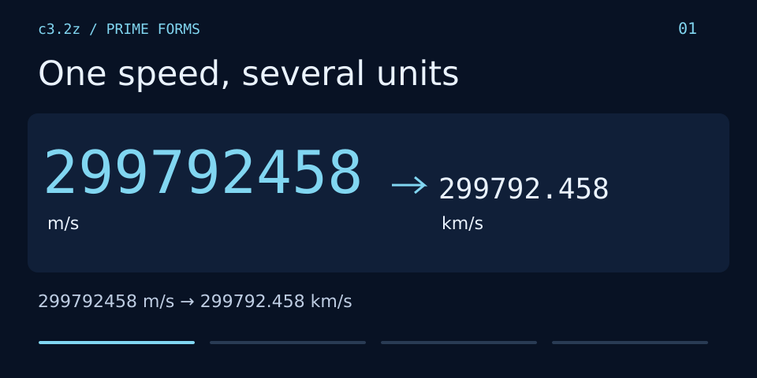

# c3._2z · The speed of light as a power tower

**This repository reads the speed of light as a power tower, digit by digit.** Every digit is a prime raised to a power, so $c = 299\,792\,458$ splits into three layers that rebuild it exactly:

| Layer | In m/s |
| --- | --- |
| Digits of c | 299792458 |
| Prime layer | 233732252 |
| Exponent layer | 122121213 (122121212 with the cap at 2) |
| Top layer | 111111111 |

The same reading is carried through every unit system. Metric values end, US customary values repeat every 42 digits ($10^{42}\equiv1 \bmod 127$) and nautical values every 154 ($10^{154}\equiv1 \bmod 463$). The page draws those cycles, maps them onto the logistic map, and reads the tower word back from its optical spectrum.

[Open the main index](index.html) · [Still preview](assets/prime-forms-walkthrough-still.png) · [Animated SVG source](assets/prime-forms-walkthrough.svg)

## Follow the implementation

| Start here | What to try |
| --- | --- |
| [Unit tree](index.html#unit-tree) | Compare exact unit conversions. In m/s the final digit is $8=2^3$. Toggle the cap or edit a digit rule and watch the stack change. |
| [Optical phase slots](index.html#phase-slots) | Turn each tower height into quarter-turns of phase. Compare the carrier and sidebands in the ideal modulation model. |
| [Prime Forms](index.html#prime-forms) and [logistic fork](index.html#logistic-fork) | Swap or bias the two strands. The knot, ribbon, rosette and loom respond to these controls. |
| [3D lattice](index.html#lattice) and [Hopf detector](index.html#dimensions) | Orbit a digit-seeded height field and average adjacent cells. Then compare a loop, its detector projection, and the fixed point produced at a different pump setting. |
| [Gain sweep](index.html#gain-title) and [research controls](index.html#research-controls) | Change one shared gain for a family of exponential towers. Compare their thresholds, then compare nearby offsets and equal-gain mirror responses. |
| [Ω towers](index.html#omega-towers), [light loop](index.html#omega-light) and [wave plate](index.html#order-of-waves) | Reverse two prime layers that share a fixed point and a slope. Their half-difference reveals the order through its leading second harmonic. |
| [Model checks](index.html#model-checks) | Inspect the live residuals and copy the current settings. |
| [From the original thread](index.html#thread-notes) | Follow the original digit, arithmetic, logistic, Catalan and CM questions into the experiments and artworks. |
| [Who made what](index.html#authorship) | The author of every section. |

The main showcase cycles through 17 stops. For a local preview, open **index.html** in a browser. [Earlier Prime Forms gallery](pages/prime-forms.html) · [Dark neon version](pages/prime-forms-index-dark.html)

## Conjectural

The [Recamán and exclusion models](index.html#conjectural) compare wall filters and rules for repeated values over finite runs. The counts apply to the selected rule and step count. A quantitative correspondence with the toy optical blockade remains an open question.

## Where the threads meet

The speed-of-light thread supplies the input, $c=299\,792\,458\ \mathrm{m/s}$, and the exact unit comparisons. The digit rule supplies the prime letters. Mirrors and logistic forks then turn those letters into paired signals, and the coarse-graining view adds a way to see what survives averaging.

The earlier Catalan and CM discussion supplied the quarter-turn motif. At the logistic two-cycle flip, the linearized two-phase map squares to $-I$. Reading one coordinate gives $\chi_4(n)=\sin(\pi n/2)$. Summing those signs with weights $1/n^2$ gives Catalan’s constant. At odd primes with $\chi_4(p)=-1$, the Gaussian CM curve $y^2=x^3-x$ has vanishing Frobenius trace.

The implemented Ω study asks a different cancellation question. Let $\Omega=W(1)$ and $T_p(x)=\Omega p^{\Omega-x}$. The compositions $T_7\circ T_5$ and $T_5\circ T_7$ have the same slope at $\Omega$. Their difference starts at second order, which is the amber trace in [The Order of Waves](index.html#order-of-waves).

**Authorship.** Zolton Farkas brought the original questions and the tower idea. GPT and Codex built the unit tree, digit towers, phase slots, Prime Forms drawings, logistic fork, gain sweep and controls, worked through the Ω calculations, drew The Order of Waves, and made the showcase tour, the thread notes and the walkthrough. Gemini (Neon) contributed the Living SPEC workspace and neon visual study, the RG lattice with the Hopf detector, the obstructions lab, the wall trees and dedup scenarios, and the model checks. Claude added the white page and blue plates, the 3D relief, the chain, unit-system and cycle sections, the spectral read-back and the Omega pencil. The [research archive](RESEARCH_ARCHIVE.md) preserves the earlier notebook and links to its scripts and results.
