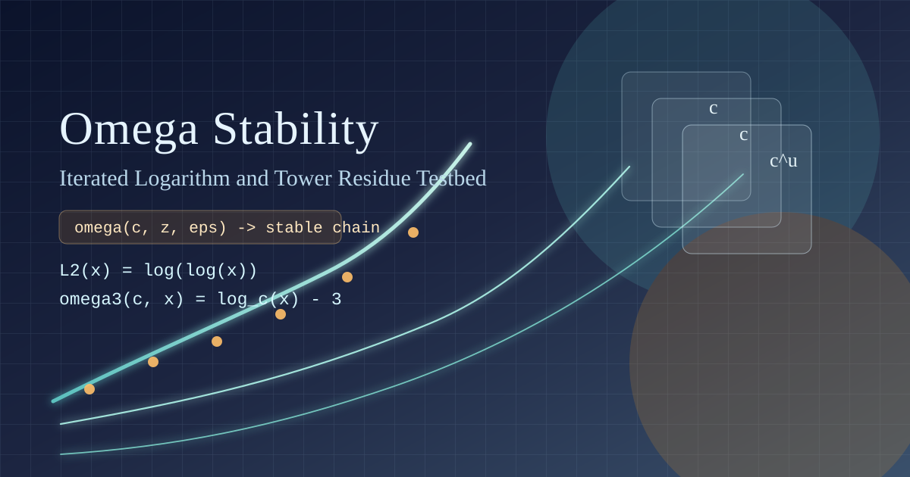

# c3.2z ·  Power tower composition in physical constants like the speed of  light. Prime power tower composition Forms. Omega wave power towers

This project studies **how perturbations travel through power towers and what survives a change of representation**. The analytic framework uses iterated logarithms to measure how a perturbation at the output of a tower propagates back through its layers. Prime Forms extends that inquiry by changing the units used to write the speed of light and reversing the order of prime-indexed maps.

<p align="center">
  
</p>

## Analytic tower framework

Start with the seed $u=2z$ and the depth-three tower $c^{c^{c^u}}$. Taking a logarithm transfers an additive perturbation back one layer. For a layer with base $b$ and unperturbed output $x$, the update is exact wherever both logarithms are defined.

$$
\log_b(x+\delta)-\log_b(x)=\frac{\ln(1+\delta/x)}{\ln b}.
$$

The script applies this update through the tower to recover the perturbation at the seed. It also sweeps the base to ask whether the response selects an interior minimum. In the recorded sweep at $z=1$, over $1.01\le c\le 2.5$, the smallest absolute remainder was at the upper endpoint. [Sweep results and validation](outputs/omega_stability/conclusions.md)

The earlier work also uses $L_2(x)=\ln\ln x$ as a coordinate for numerical optimization and root-finding. The [research archive](RESEARCH_ARCHIVE.md) preserves the original README, experiment inventory, and null models.

## Two constructions in Prime Forms

**A change of units changes the digit tower.** Write the vacuum speed of light as `299792458` in metres per second. Counting prime factors with multiplicity in each digit gives `122121213`. Capping each count at two gives `122121212`. The only change is the third factor of $2$ in $8=2^3$. You can reproduce the calculation with the unit selector and tower controls. The speed is the same physical quantity throughout, and the encoding depends on the displayed number.

**Reversing two layers preserves the slope and changes the wave.** Let $\Omega=W(1)$ and set $T_p(x)=\Omega p^{\Omega-x}$ for prime $p$. Both compositions $T_q\circ T_p$ and $T_p\circ T_q$ fix $\Omega$ and have derivative $\Omega^2\ln p\ln q$ there. For distinct primes their second derivatives differ. With a small sinusoidal input around $\Omega$, the mean-subtracted half-difference of the two outputs therefore has a leading second harmonic. The Ω towers screen computes the comparison, and [The Order of Waves](assets/omega-tower-waves.png) draws it.

## Explore the implementation

Open [index.html](index.html) in a browser from a local checkout to run Prime Lab. The gallery combines a draggable lattice, prime forms, and feedback experiments. Neo developed the visual layout and the helper that exports the current settings and live checks as a Markdown specification. The main tour cycles through 17 stops, including [From the original thread](index.html#thread-notes).

| Screen | What you can examine |
| --- | --- |
| [Optical phase slots](index.html#phase-slots) | An ideal phase-modulation spectrum driven by digit-factor layers |
| [Logistic fork](index.html#logistic-fork) | Even and odd mirror responses as the strands are swapped or biased |
| [Hopf detector](index.html#dimensions) | Projecting an orbit to a detector and varying the pump setting |
| [Gain sweep](index.html#gain-title) | Stability thresholds across a family of towers driven by one gain |

<p align="center">
  <a href="assets/c32z-walkthrough.png">
    
  </a>
</p>

[Animated walkthrough (APNG)](assets/c32z-walkthrough.png)

## Reproduce the analytic sweep

```bash
python -m pip install numpy matplotlib
python omega_stability_tests.py --output-dir /tmp/omega-stability
```

The [reference outputs](outputs/omega_stability/) include the base sweep, the perturbation profiles, and a comparison against direct evaluation. The [applications](applications/) show the double-log coordinate in optimization and root-finding.

## From the original thread

The project grew from Zolton’s question about which patterns in the digits of the speed of light could survive a change in representation. The [original walkthrough](index.html#thread-notes) follows that question through the Goldbach and Collatz examples, the logistic quarter-turn, Catalan’s disk, and the prime-layer wave experiment.

[](assets/prime-forms-walkthrough.png)

[Still preview](assets/prime-forms-walkthrough-still.png) · [Animated SVG](assets/prime-forms-walkthrough.svg) · [Earlier gallery](pages/prime-forms.html)

## Conjectural · Recamán and exclusion models

The [Recamán lab](index.html#conjectural) compares wall filters, duplicate counts, and alternative step rules over finite runs. Each count refers to the selected rule and step count. A quantitative correspondence with the toy optical blockade remains an open question.
